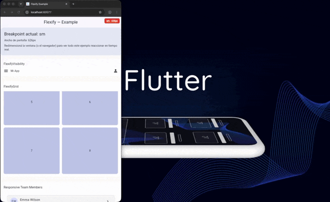
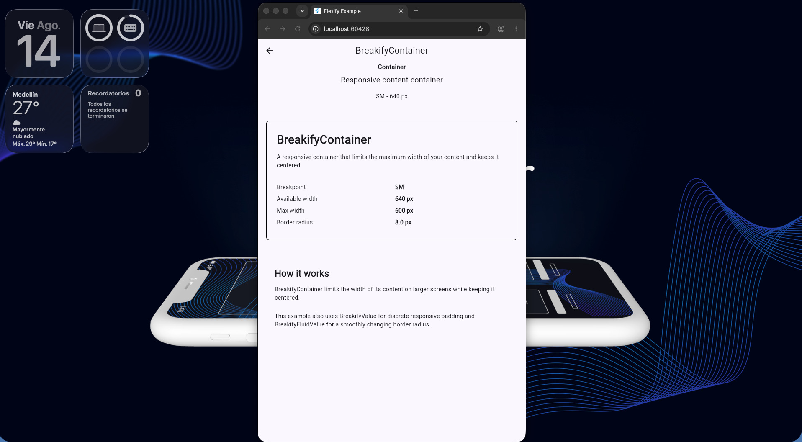
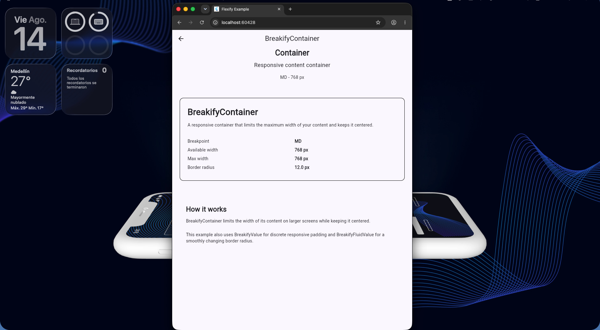
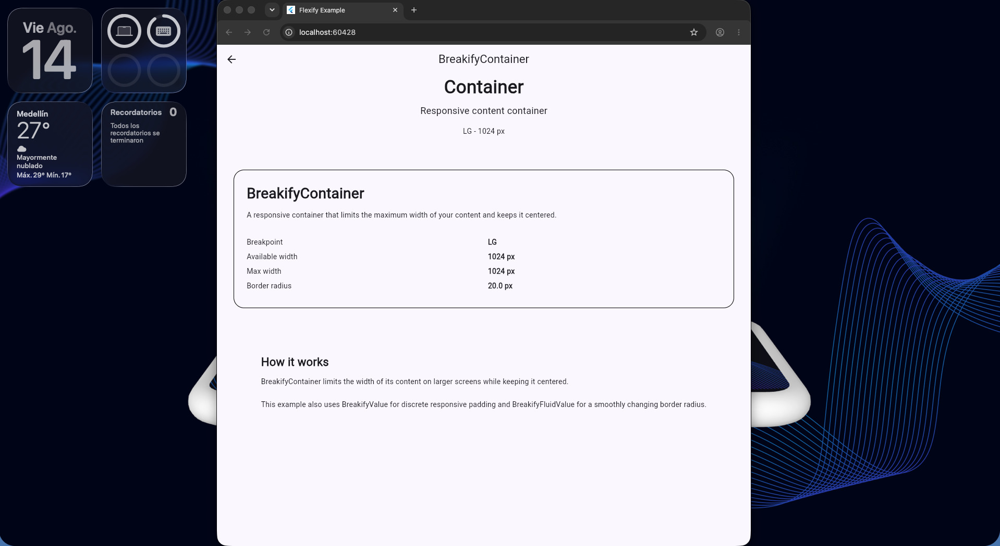
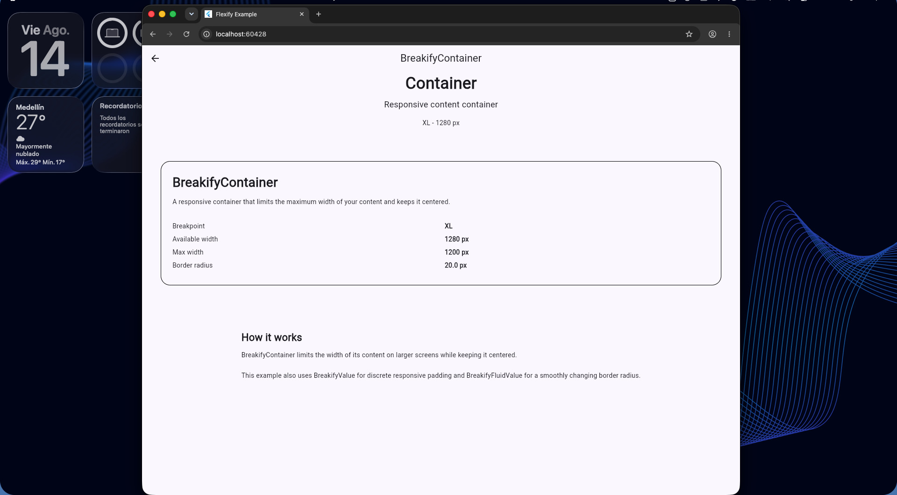
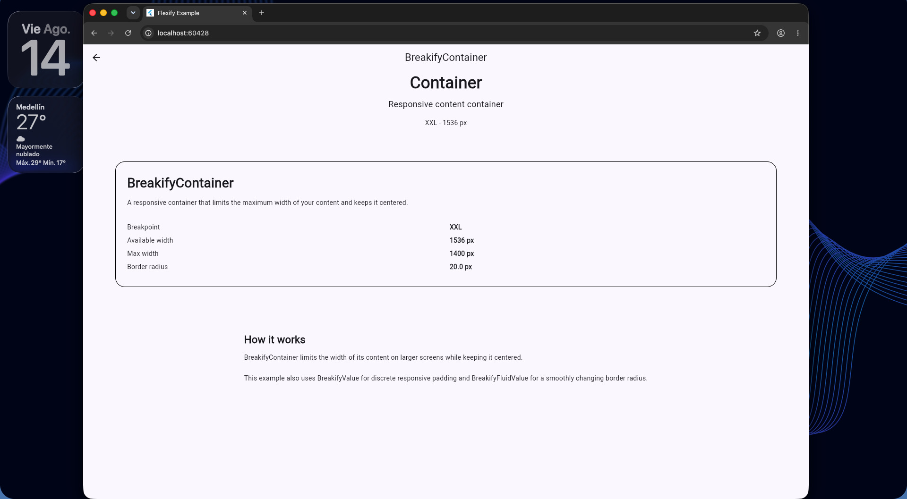

<h1 align="start">Breakify</h1>

<p align="start">
  <strong>Un toolkit de layout responsivo para Flutter.</strong>
</p>

<p align="start">
  Construye interfaces responsivas usando breakpoints, valores responsivos,
  interpolación fluida y widgets adaptativos.
</p>

<p align="center">
  <a href="https://pub.dev/packages/breakify">
    
  </a>
  <a href="https://github.com/josueSerna/breakify">
    
  </a>
  <a href="https://pub.dev/packages/breakify">
    
  </a>
  <a href="https://pub.dev/packages/breakify">
    
  </a>
  <a href="https://github.com/josueSerna/breakify/blob/main/LICENSE">
    
  </a>
  
</p>

<p align="center">
  
</p>


  <p align="center">
    
  </p>
---

## Tabla de Contenidos

- [Últimas Actualizaciones Importantes](#últimas-actualizaciones-importantes)
- [¿Qué es Breakify?](#qué-es-breakify)
- [¿Por qué Breakify?](#por-qué-breakify)
- [Características](#características)
- [Requisitos](#requisitos)
- [Instalación](#instalación)
- [Inicio Rápido](#inicio-rápido)
- [Breakpoints por Defecto](#breakpoints-por-defecto)
- [Valores Responsivos](#valores-responsivos)
- [Valores Fluidos](#valores-fluidos)
- [Extensiones de BuildContext](#extensiones-de-buildcontext)
- [Widgets](#widgets)
  - [BreakifyAdaptativeLayout](#breakifyadaptativelayout)
  - [BreakifyGrid](#breakifygrid)
  - [BreakifyResponsiveGrid](#breakifyresponsivegrid)
  - [BreakifyPanelLayout](#breakifypanellayout)
  - [BreakifyListView](#breakifylistview)
  - [BreakifyContainer](#breakifycontainer)
  - [BreakifySection (experimental)](#breakifysection-experimental)
  - [BreakifyNavbar (experimental)](#breakifynavbar-experimental)
  - [BreakifyVisibility](#breakifyvisibility)
  - [BreakifyBuilder](#breakifybuilder)
  - [BreakifyDebugBanner](#breakifydebugbanner)
- [Vista Previa Responsiva](#vista-previa-responsiva)
- [App de Ejemplo](#app-de-ejemplo)
- [Contribuir](#contribuir)
- [Licencia](#licencia)
- [Autor](#autor)

---

## Últimas Actualizaciones Importantes

### `heightMode` reemplaza a `equalHeight` en `BreakifyGrid` y `BreakifyResponsiveGrid`

> **Cambio incompatible (breaking).** El booleano `equalHeight` ya no existe.
> Fue reemplazado por `heightMode`, un enum `BreakifyHeightMode` nullable que
> permite elegir *cómo* se calcula la altura de los ítems.

| `heightMode` | Comportamiento | `Spacer` / `Expanded` | Carga |
|---|---|---|---|
| `null` (por defecto) | Los ítems se dimensionan con `childAspectRatio` | n/a | Perezosa |
| `BreakifyHeightMode.equal` | Todos los ítems tienen exactamente la misma altura: la del ítem más alto de todo el grid | Soportado | Las filas se miden una vez y se guarda en caché; solo las filas visibles permanecen vivas |
| `BreakifyHeightMode.equalInRow` | Los ítems de cada fila tienen la altura del ítem más alto de esa fila. Las filas pueden diferir entre sí | Soportado | Perezosa |
| `BreakifyHeightMode.natural` | Cada ítem conserva su altura natural, alineado arriba de su fila | No soportado (altura sin límite) | Perezosa |

Cuando `heightMode` no es `null`, `childAspectRatio` se ignora y las alturas
salen del contenido. Actualmente solo soporta `Axis.vertical` en
`BreakifyGrid`, y los hijos deben admitir medición intrínseca (widgets como
`LayoutBuilder` no están soportados).

**Migración**

```dart
// Antes
BreakifyGrid(
  columns: const BreakifyValue(sm: 1, md: 2, lg: 3),
  equalHeight: true,
  children: cards,
)

// Después (mismo comportamiento que el antiguo `equalHeight: true`)
BreakifyGrid(
  columns: const BreakifyValue(sm: 1, md: 2, lg: 3),
  heightMode: BreakifyHeightMode.equalInRow,
  children: cards,
)
```

`equalHeight: false` pasa a ser `heightMode: null` (o simplemente omitirlo).

**Cómo elegir el modo**

* Usa `equalInRow` para listas largas o con scroll: es perezoso y barato.
* Usa `equal` cuando todas las tarjetas deben verse idénticas entre filas. Su
  primer layout y cada cambio de ancho miden todas las tarjetas, así que
  conviene hasta unos pocos cientos de ítems.
* Usa `natural` cuando las tarjetas deben conservar su tamaño. No pongas
  `Spacer` ni `Expanded` en su `Column`; usa `mainAxisSize: MainAxisSize.min`.

`BreakifyHeightMode` se exporta desde `package:breakify/breakify.dart`.
Consulta el [CHANGELOG](CHANGELOG.md) para más detalles.

---

## ¿Qué es Breakify?

Breakify es un toolkit de layout responsivo ligero para Flutter, diseñado para facilitar la construcción y el mantenimiento de UIs responsivas.

En vez de revisar repetidamente las dimensiones de pantalla en tus widgets:

```dart
if (MediaQuery.sizeOf(context).width >= 1024) {
  // ...
}
```

Breakify te permite describir **cómo debe comportarse un valor o un layout** según el tamaño de pantalla, y se encarga de resolverlo por ti.

---

## ¿Por qué Breakify?

Sin Breakify, los layouts responsivos suelen requerir revisar manualmente el tamaño de pantalla en cada widget:

```dart
if (MediaQuery.sizeOf(context).width >= 1024) {
  ...
}
```

o recurrir a un `LayoutBuilder` cada vez:

```dart
LayoutBuilder(
  builder: (context, constraints) {
    // ...
  },
)
```

Con Breakify, la misma lógica se vuelve declarativa:

```dart
BreakifyAdaptativeLayout(
  breakpoint: BreakifyBreakpoint.lg,
  spacing: const BreakifyFluidValue(
    sm: 12,
    lg: 24,
  ),
  children: [
    LeftPanel(),
    RightPanel(),
  ],
)
```

| Sin Breakify | Con Breakify |
|---|---|
| Chequeos de tamaño de pantalla dispersos en los widgets | Lógica responsiva centralizada en un solo valor |
| Boilerplate manual de `LayoutBuilder` en cada widget | Widgets adaptativos incluidos |
| Saltos abruptos entre breakpoints | Interpolación fluida opcional |
| Fácil olvidar el caso de algún breakpoint | Fallback automático al valor definido más cercano |

La lógica responsiva se mantiene centralizada, haciendo tus widgets más fáciles de leer, mantener y reutilizar.

---

## Características

* Breakpoints responsivos
* Valores fluidos con interpolación suave
* Layouts adaptativos de fila/columna
* Contenedores responsivos
* Grids responsivos, con columnas explícitas o automáticas
* Grids horizontales y filas de igual altura
* Listas responsivas (verticales y horizontales)
* Layouts de panel principal y paneles secundarios
* Secciones de página experimentales (`BreakifySection`)
* Navbar responsivo experimental (`BreakifyNavbar`)
* Visibilidad condicional según breakpoint, global o local
* Banner de breakpoint configurable para desarrollo

---

## Requisitos

* Dart SDK `>=3.0.0`
* Flutter SDK `>=3.10.0`

---

## Instalación

Agrega Breakify a tu `pubspec.yaml`.

```yaml
dependencies:
  breakify: ^0.3.0
```

Luego importa el paquete.

```dart
import 'package:breakify/breakify.dart';
```

---

## Inicio Rápido

Envuelve tu aplicación con `BreakifyScope`.

```dart
void main() {
  runApp(
    BreakifyScope(
      child: MaterialApp(
        home: HomePage(),
      ),
    ),
  );
}
```

Esto hace que la información responsiva esté disponible en todo el árbol de widgets.

---

## Breakpoints por Defecto

Breakify incluye cinco breakpoints responsivos por defecto.

| Breakpoint | Ancho mínimo |
| ---------- | ------------: |
| sm         |           640 |
| md         |           768 |
| lg         |          1024 |
| xl         |          1280 |
| xxl        |          1536 |

También puedes definir tu propia configuración de breakpoints para adaptar los diseños a las necesidades de tu proyecto.

```dart
const breakpoints = BreakifyBreakpoints(
  sm: 500,
  md: 700,
  lg: 900,
  xl: 1200,
  xxl: 1600,
);
```

```dart
BreakifyScope(
  breakpoints: breakpoints,
  child: MyApp(),
)
```

> **Nota:** todos los anchos de breakpoint mostrados en este README —
> incluyendo la [Vista Previa Responsiva](#vista-previa-responsiva) más
> abajo — usan estos valores por defecto. Como los breakpoints son
> totalmente personalizables, tu propia app puede cambiar de layout en
> anchos diferentes.

Cada breakpoint se activa desde su ancho mínimo, incluido el límite exacto.
Por ejemplo, con `xl: 1400`, `xl` se resuelve desde `1400` píxeles.

---

## Valores Responsivos

En vez de revisar manualmente el ancho de pantalla, define cómo debe comportarse un valor.

```dart
const columns = BreakifyValue(
  sm: 1,
  md: 2,
  lg: 4,
);

final value = context.resolve(columns);
```

Los breakpoints no definidos heredan automáticamente el valor anterior más cercano.

Por ejemplo:

| Breakpoint | Valor |
| ---------- | ----: |
| sm         |     1 |
| md         |     2 |
| lg         |     4 |
| xl         |     4 |
| xxl        |     4 |

---

## Valores Fluidos

¿Necesitas que los valores escalen suavemente en vez de cambiar de forma abrupta?

Usa `BreakifyFluidValue`.

```

`BreakifyValue` es genérico, por lo que puede resolver valores como `int`,
`double`, `EdgeInsets` u otros tipos usados por los widgets responsivos. El
valor `sm` es obligatorio; los breakpoints superiores heredan el valor más
reciente que haya sido definido.dart
const spacing = BreakifyFluidValue(
  sm: 8,
  md: 16,
  lg: 24,
);

Container(
  padding: EdgeInsets.all(
    context.resolve(spacing),
  ),
)
```

En vez de saltar de un valor a otro, Breakify interpola entre breakpoints.

La interpolación es lineal entre cada par de valores definidos. Antes del
primer punto se usa el primer valor y después del último punto se usa el
último valor. Si un valor fluido necesita otra configuración de breakpoints,
puedes usar `overrideBreakpoints`. Usa `resolveRounded` cuando quieras
redondear el resultado al píxel lógico más cercano.

---

## Extensiones de BuildContext

Breakify provee extensiones útiles para acceder a la información responsiva.

```dart
context.breakpoint
```

Retorna el breakpoint actual.

En widgets que usan `BreakifyScope`, es el breakpoint resuelto a partir del
ancho del scope. Los widgets que usan `BreakifyBuilder` resuelven el
breakpoint a partir del ancho local de sus `BoxConstraints`.

```dart
context.breakifyWidth
```

Retorna el ancho actual.

```dart
context.resolve(value)
```

Resuelve cualquier `BreakifyResolvable`.

---

## Widgets

### BreakifyAdaptativeLayout

Cambia automáticamente entre un `Column` y un `Row`.

```dart
BreakifyAdaptativeLayout(
  breakpoint: BreakifyBreakpoint.lg,
  spacing: const BreakifyValue(
    sm: 12,
    lg: 24,
  ),
  children: [
    Sidebar(),
    Content(),
  ],
)
```

`distributeEvenly` controla si los hijos horizontales usan `Expanded`
(`true`) o `Flexible` (`false`). `stretchChildren` aplica
`CrossAxisAlignment.stretch` al layout vertical. El espaciado puede ser un
`BreakifyValue` o un `BreakifyFluidValue`.

---

### BreakifyGrid

Grid responsivo con columnas, espaciado y aspect ratio configurables.

```dart
BreakifyGrid(
  columns: const BreakifyValue(
    sm: 2,
    md: 3,
    lg: 4,
  ),
  spacing: const BreakifyFluidValue(
    sm: 8,
    lg: 20,
  ),
  children: products,
)
```

`columns`, `spacing`, `crossAxisSpacing`, `mainAxisSpacing` y
`childAspectRatio` aceptan valores responsivos. Si se proporcionan
`spacing` y un espaciado específico por eje, el valor específico tiene
prioridad. `padding`, `physics`, `shrinkWrap` y `scrollDirection` se pasan al
grid desplazable subyacente.

También soporta:

* **Scroll horizontal** — configura `scrollDirection: Axis.horizontal`
  para desplazarse hacia los lados en vez de verticalmente. En este modo,
  `columns` controla el número de filas en vez de columnas, y
  `childAspectRatio` se sigue expresando como ancho / alto.
* **Modos de altura** — configura `heightMode` (un `BreakifyHeightMode`) para
  dimensionar los ítems según su contenido en lugar de `childAspectRatio`,
  que entonces se ignora.
  * `BreakifyHeightMode.equal`: todos los ítems tienen la misma altura (la
    del más alto de todo el grid).
  * `BreakifyHeightMode.equalInRow`: los ítems de cada fila igualan al más
    alto de esa fila; las filas pueden diferir.
  * `BreakifyHeightMode.natural`: cada ítem conserva su propia altura.

  Las alturas se miden una vez, por lo que `Spacer` y `Expanded` dentro de un
  `Column` funcionan (excepto con `natural`). Los hijos deben admitir
  medición intrínseca (`LayoutBuilder` no está soportado). Actualmente solo
  soportado con `Axis.vertical`. Consulta
  [Últimas Actualizaciones Importantes](#últimas-actualizaciones-importantes).

```dart
BreakifyGrid(
  columns: const BreakifyValue(sm: 1, md: 2, lg: 3),
  scrollDirection: Axis.horizontal,
  spacing: const BreakifyFluidValue(sm: 8, lg: 20),
  children: cards,
)
```

### BreakifyResponsiveGrid

Calcula automáticamente cuántas columnas caben manteniendo un ancho mínimo
para cada ítem.

```dart
BreakifyResponsiveGrid(
  minItemWidth: 240,
  maxColumns: 4,
  spacing: 16,
  children: products,
)
```

A diferencia de `BreakifyGrid`, que usa un número de columnas responsive
explícito, `BreakifyResponsiveGrid` calcula las columnas usando el ancho local
proporcionado por su padre. `minItemWidth` define el ancho mínimo deseado de
cada ítem, `maxColumns` limita opcionalmente el resultado y `spacing` se
incluye al calcular el espacio entre columnas.

Cuando el padre no proporciona un ancho limitado, el grid usa `minItemWidth`
como ancho finito de respaldo.

La cantidad de columnas se calcula usando el ancho disponible después de
descontar el padding horizontal y el espacio entre ítems. `maxColumns` limita
el resultado y siempre se usa al menos una columna. A diferencia de
`BreakifyGrid`, este widget no requiere definir un valor para cada breakpoint y
responde al ancho local proporcionado por su padre.

Configura `heightMode` (`BreakifyHeightMode.equal`, `equalInRow` o `natural`)
para dimensionar los ítems según su contenido. Es opcional (`null` por
defecto) e ignora `childAspectRatio`. El número de columnas se sigue
calculando según el ancho disponible. Consulta
[Últimas Actualizaciones Importantes](#últimas-actualizaciones-importantes)
para ver el comportamiento de cada modo.

```dart
BreakifyResponsiveGrid(
  minItemWidth: 220,
  maxColumns: 3,
  spacing: 16,
  heightMode: BreakifyHeightMode.equalInRow,
  children: [
    Card(child: Text('Contenido corto')),
    Card(child: Text('Contenido que necesita más espacio vertical.')),
  ],
)
```

---

### BreakifyPanelLayout

Coloca un panel principal junto a una columna vertical de paneles secundarios
a partir del breakpoint seleccionado.

```dart
BreakifyPanelLayout(
  breakpoint: BreakifyBreakpoint.lg,
  spacing: const BreakifyFluidValue(sm: 12, lg: 24),
  mainPanel: MainContent(),
  secondaryPanels: [
    SummaryCard(),
    ActionsCard(),
  ],
)
```

Por debajo del breakpoint, todos los paneles se organizan verticalmente. En
el breakpoint, el panel principal y la columna secundaria se organizan
horizontalmente.

`mainFlex` y `secondaryFlex` controlan la proporción de ancho en el layout
horizontal. Si `secondaryPanels` está vacío, el layout permanece vertical. El
breakpoint se resuelve usando el ancho local disponible para el layout, por lo
que el padding o las constraints del padre pueden hacer que sea diferente del
breakpoint global de la pantalla.

---

### BreakifyListView

Lista responsiva con espaciado y separadores configurables.

```dart
BreakifyListView(
  spacing: const BreakifyValue(
    sm: 8,
    lg: 16,
  ),
  itemCount: items.length,
  itemBuilder: (context, index) {
    return ListTile(
      title: Text(items[index]),
    );
  },
)
```

Soporta un widget `separator` personalizado (que reemplaza el espaciado por
defecto) y `scrollDirection: Axis.horizontal` para listas horizontales.

Cuando se proporciona `separator`, reemplaza el espaciado responsivo entre
ítems. Usa `shrinkWrap` y una física de scroll adecuada al colocar la lista
dentro de otro widget desplazable. En modo horizontal, el espaciado se aplica
sobre el eje horizontal.

---

### BreakifyContainer

Centra el contenido limitando su ancho máximo.

```dart
BreakifyContainer(
  maxWidth: const BreakifyValue(
    sm: 1200,
  ),
  child: content,
)
```

`maxWidth` y `padding` aceptan `BreakifyValue` y `BreakifyFluidValue`.
`margin` y `alignment` usan los tipos de layout normales de Flutter.

---

### BreakifySection (experimental)

> **Experimental en 0.3.0:** su API podría cambiar en próximas versiones.

Sección de ancho completo para páginas web y landing pages. Admite fondo,
alineación, `padding` y `minHeight` responsivos, y `fullViewport`. Usa
`childScale` para agrandar o reducir visualmente el contenido sin cambiar el
espacio que reserva el layout; puede ser útil para escalar un logo en el
footer. La sección no recorta el contenido que sobresale al escalarlo, aunque
un widget ancestro sí podría hacerlo.

```dart
BreakifySection(
  backgroundColor: Colors.indigo.shade50,
  minHeight: const BreakifyValue(sm: 130),
  childScale: 2,
  alignment: Alignment.centerRight,
  padding: const BreakifyValue<EdgeInsetsGeometry>(
    sm: EdgeInsets.all(16),
    lg: EdgeInsets.symmetric(horizontal: 96, vertical: 48),
  ),
  child: const FlutterLogo(size: 64),
)
```

`padding` y `minHeight` aceptan `BreakifyValue` y `BreakifyFluidValue`. Con
`fullViewport: true` la altura mínima es la del viewport
(`MediaQuery.sizeOf(context).height`); si también defines `minHeight`, se usa
el mayor. La sección crece cuando su contenido lo necesita y no crea scroll
propio, así que colócala dentro de un `ListView` o `SingleChildScrollView`.
Requiere un `BreakifyScope`.

---

### BreakifyNavbar (experimental)

> **Experimental en 0.3.0:** su API podría cambiar en próximas versiones.

Navbar responsivo. Desde el `breakpoint` (por defecto `md`) las opciones se
muestran en horizontal; por debajo, un botón hamburguesa abre un menú
`dropdown` o `drawer`.

```dart
BreakifyNavbar(
  logo: Image.asset('assets/logo.png', height: 32),
  items: [
    BreakifyNavbarItem(label: 'Inicio', icon: Icons.home, onTap: () {}),
    BreakifyNavbarItem(label: 'Servicios', icon: Icons.work, onTap: () {}),
    BreakifyNavbarItem(label: 'Contacto', onTap: () {}, enabled: false),
  ],
  menuType: BreakifyNavbarMenuType.drawer,
  drawerSide: BreakifyNavbarDrawerSide.right,
  scrollBehavior: BreakifyNavbarScrollBehavior.hideOnScroll,
  body: ListView(children: [/* contenido de la página */]),
)
```

- `menuType`: `dropdown` (se despliega bajo el navbar) o `drawer` (panel
  lateral sobre el contenido; se cierra tocando fuera, con el icono de cierre
  o al elegir una opción).
- `scrollBehavior`: `fixed` (siempre visible, por defecto), `static` (se va
  con el contenido) o `hideOnScroll` (se oculta al bajar y vuelve al subir;
  `scrollThreshold` define la sensibilidad).
- También configurable: `logo`, `menuIcon`, `closeIcon`, `backgroundColor`,
  `foregroundColor`, `menuBackgroundColor`, `height`, `padding`,
  `itemSpacing`, `drawerWidth`, `drawerOverlayColor`, `animationDuration`
  y `elevation`.

Limitaciones conocidas:

- Requiere un `BreakifyScope` y un ancestro Material.
- Envuelve el contenido de la página en `body`. Escucha las notificaciones de
  scroll de `body` y nunca usa un `ScrollController`.
- Con `fixed` y `hideOnScroll` el body se coloca debajo del navbar. Con
  `static` el navbar se superpone al body, que debe aplicar el padding
  superior (`MediaQuery.paddingOf(context).top`) si usa un `padding` propio,
  `SingleChildScrollView` o `CustomScrollView`.
- `static` y `hideOnScroll` necesitan un scrollable vertical de nivel
  superior en `body`.
- Las opciones de escritorio no hacen scroll: demasiadas opciones desbordan.
- El botón atrás de Android no cierra el menú móvil.

---

### BreakifyVisibility

Muestra u oculta widgets según el breakpoint actual.

```dart
BreakifyVisibility(
  minBreakpoint: BreakifyBreakpoint.lg,
  child: Sidebar(),
)
```

O muestra solo en breakpoints específicos.

```dart
BreakifyVisibility.only(
  visibleIn: {
    BreakifyBreakpoint.sm,
    BreakifyBreakpoint.xl,
  },
  child: Logo(),
)
```

Usa `mode: BreakifyVisibilityMode.local` para resolver la visibilidad según
el ancho disponible para el widget, en lugar del ancho global de
`BreakifyScope`.

El modo predeterminado es `BreakifyVisibilityMode.global`. Usa
`minBreakpoint` para mostrar el hijo desde un breakpoint en adelante,
`maxBreakpoint` para mostrarlo hasta un breakpoint, o ambos para definir un
rango inclusivo. `replacement` se muestra mientras el hijo está oculto; si no
se proporciona, se usa un `SizedBox` vacío.

```dart
BreakifyVisibility(
  minBreakpoint: BreakifyBreakpoint.lg,
  mode: BreakifyVisibilityMode.local,
  replacement: MobileMenu(),
  child: DesktopSidebar(),
)
```

`global` usa el ancho expuesto por `BreakifyScope`; `local` usa el ancho finito
disponible en el lugar donde está colocado el widget. Si el ancho local no
está limitado, se utiliza el ancho global como respaldo.

---

### BreakifyBuilder

Construye widgets según el breakpoint actual.

```dart
BreakifyBuilder(
  builder: (context, breakpoint, constraints) {
    return Text(
      breakpoint.name,
    );
  },
)
```

El builder recibe el `BuildContext` actual, el `BreakifyBreakpoint` resuelto y
las `BoxConstraints` locales. Es útil cuando necesitas un comportamiento
personalizado que no cubren los widgets incluidos.

---

### BreakifyDebugBanner

Muestra el breakpoint actual durante el desarrollo.

```dart
BreakifyDebugBanner(
  child: MyApp(),
)
```

Usa `enabled` para ocultar el banner sin quitarlo del árbol, `corner` para
seleccionar una de las cuatro esquinas y `breakpoints` para usar una
configuración personalizada. Está pensado para desarrollo y normalmente debe
desactivarse en producción.

El banner resuelve su breakpoint usando el ancho local. Si se coloca dentro
de un contenedor con restricciones, muestra el breakpoint de ese contenedor
en lugar del breakpoint global de la pantalla. Si el ancho local no está
acotado, usa como respaldo el ancho proporcionado por `BreakifyScope`.

En la app de ejemplo, el banner añadido mediante `MaterialApp.builder`
representa la vista global de la ventana y aparece en todas las pantallas de
ejemplo. La pantalla principal también incluye un banner dentro de un
contenedor acotado de 720 px para comparar los breakpoints global y local al
redimensionar la ventana.

```dart
BreakifyDebugBanner(
  enabled: true,
  corner: BreakifyBannerCorner.bottomLeft,
  child: MyApp(),
)
```

---

## Vista Previa Responsiva

Las capturas de abajo fueron tomadas de la app en [`/example`](example),
redimensionada en cada breakpoint.

> Estas capturas usan los anchos de breakpoint **por defecto** de Breakify
> (ver la tabla de [Breakpoints por Defecto](#breakpoints-por-defecto) más
> arriba). Los breakpoints son totalmente personalizables mediante
> `BreakifyBreakpoints`, así que una app con valores personalizados
> cambiará de layout en anchos distintos — lo que se mantiene consistente
> es el *comportamiento* (cuántas columnas, cómo se adapta el layout), no
> el valor exacto en píxeles.

<table align="center">
  <tr>
    <td align="center">
      <br>
      <sub><b>sm</b> · teléfono</sub>
    </td>
    <td align="center">
      <br>
      <sub><b>md</b> · teléfono grande / tablet pequeña</sub>
    </td>
    <td align="center">
      <br>
      <sub><b>lg</b> · tablet / laptop pequeña</sub>
    </td>
    <td align="center">
      <br>
      <sub><b>xl</b> · laptop / escritorio</sub>
    </td>
    <td align="center">
      <br>
      <sub><b>xxl</b> · escritorio grande</sub>
    </td>
  </tr>
</table>

<!--
  Cómo regenerar estas capturas:
  1. Corre la app de ejemplo: flutter run -d chrome
  2. Redimensiona la ventana del navegador a cada ancho de breakpoint
     por defecto (640, 768, 1024, 1280, 1536) — o un ancho representativo
     justo por encima de cada uno.
  3. Toma una captura y guárdala como assets/preview_<breakpoint>.png
-->

---

## App de Ejemplo

Una aplicación de ejemplo completa está disponible en la carpeta [`example`](example).

Ejecuta el ejemplo en Flutter Web:

```bash
flutter run -d chrome
```

O ejecútalo en cualquier dispositivo conectado (Android, iOS, escritorio, o el emulador por defecto):

```bash
flutter run
```

---

## Licencia

Este proyecto está licenciado bajo la Licencia MIT.

## Autor

Desarrollado y mantenido por Josue Serna Muñoz.

GitHub: https://github.com/josueSerna